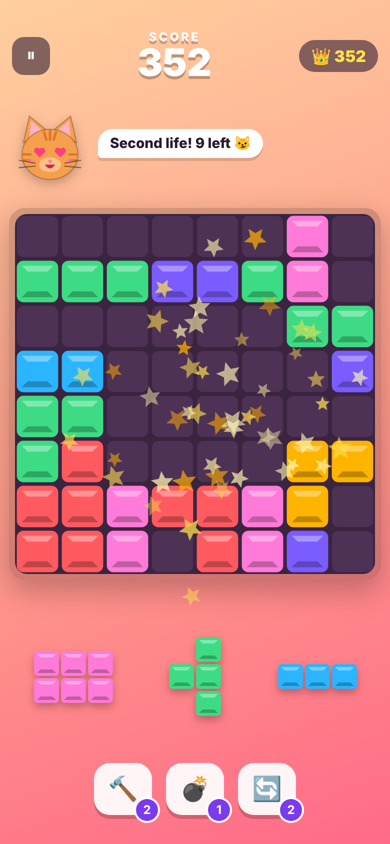

# Blockitty: Cat Block Blast 🐱🧱

Block puzzle 8×8 (il formato di *Block Blast!*, n.1 per download su Google Play USA) con una
**collezione di gatti, skin, temi ed effetti**. È pensato per chi compra cosmetici e funzioni extra.



## 1. Analisi di mercato (Google Play USA, ottobre 2026)

| Classifica | Chi domina | Cosa ci dice |
|---|---|---|
| **Top Free** | Meowdoku (sudoku con gatti), Royal Smash!, Gossip Harbor, Rotate Rings, Roblox, Block Blast!, Vita Mahjong, Magic Sort! | I **puzzle casual** dominano i download. I **gatti** sono il tema virale (Meowdoku è esploso grazie ai video brevi). |
| **Top Grossing** | Monopoly GO!, Last War, Royal Match, Candy Crush, Whiteout Survival, Coin Master, Roblox, Pokémon TCG Pocket, Township | I soldi arrivano da **collezioni** (gli album di sticker di Monopoly GO, l'apertura di pacchetti di Pokémon TCG Pocket), dai **cosmetici** (Roblox) e dalle **offerte a tempo**. |

**Il vuoto di mercato:** Block Blast e Meowdoku hanno decine di milioni di giocatori, ma guadagnano
quasi solo con la pubblicità. Meowdoku, ad esempio, ha il 100% dei ricavi da ads e nessun acquisto in-app.
Il loro pubblico non ha niente su cui spendere. Blockitty unisce il gameplay del trend n.1 per download
(block puzzle + gatti) alle meccaniche di spesa dei giochi che incassano di più:

- **Collezione a set** stile album di Monopoly GO: 6 set da 5 gatti più gli esclusivi. Ogni set completato dà un grande premio.
- **Mystery Box** stile apertura pacchetti: 5 rarità (Common → Mythic), pity garantito (Epic ogni 10, Legendary entro 60), i doppioni diventano 🧶 Yarn per craftare l'oggetto che manca.
- **Paw Pass** stagionale (28 giorni, 30 tier): traccia free e premium. Il premium restituisce più gemme di quante ne costa (960 contro 950), come i battle pass di Fortnite, e ha 2 gatti, 1 tema Mythic e 1 effetto esclusivi.
- **Negozio giornaliero a rotazione** con timer (FOMO), **Starter Pack** una tantum a $2.99 ("valore $14.99"), gem pack da $0.99 a $49.99.
- **Ritenzione**: login a 7 giorni, 3 missioni al giorno, ruota della fortuna, Daily Challenge uguale per tutti (seed giornaliero), livelli giocatore, revive gratuito una volta al giorno.
- **Pay-for-looks**, non pay-to-win: lo scoring non dipende da cosa si compra. I power-up si comprano con monete guadagnate giocando. Le probabilità delle box sono pubbliche (richiesto da Google Play).

## 2. Contenuti

- **Gameplay**: trascini i pezzi, completi righe e colonne, combo con 3 mosse di tolleranza, bonus Perfect Clear. Il generatore di pezzi è "equo": se possibile almeno un pezzo entra sempre.
- **Power-up**: 🔨 Martello (1 blocco), 💣 Bomba (area 3×3), 🔄 Shuffle.
- **Gatto compagno** animato che reagisce alle mosse (felice, innamorato, wow, shock).
- **33 gatti** procedurali in SVG, **11 skin** per i blocchi (glossy, neon, pixel, galaxy, oro, gemme...), **8 temi**, **8 effetti** particellari.
- Suoni sintetizzati (WebAudio) e vibrazione. Funziona **offline**. La partita in corso viene salvata e si riprende con *Continue*.

## 3. Installazione

### Android (APK)
Ogni push che tocca `blockitty/` avvia il workflow **Blockitty Android APK**: test, progetto Capacitor, `assembleDebug`.
Scarica l'artifact `blockitty-apk` dalla pagina Actions e installalo sul telefono (abilita "origini sconosciute").

In locale (servono Android SDK e Java 17):
```bash
cd blockitty
npm install
npm run android:init     # solo la prima volta
npm run android:apk      # -> android/app/build/outputs/apk/debug/app-debug.apk
```

### Web / PWA (installabile da Chrome)
```bash
cd blockitty && npm start   # http://localhost:8080
```
Il workflow **Blockitty Web** pubblica su GitHub Pages ad ogni push su `main`. Va abilitato una volta da Settings → Pages → Source: GitHub Actions.
Dal telefono apri il link e scegli "Installa app".

### Pubblicazione sul Play Store
1. Account Google Play Console ($25 una tantum).
2. Crea in Play Console i prodotti in-app con gli SKU di `js/data.js` (`gems_80`, `gems_500`, `gems_1200`, `gems_2600`, `gems_7000`, `starter_pack`).
3. Pacchetto consigliato: **Trusted Web Activity** (Bubblewrap o PWABuilder) puntato al sito su Pages. In TWA `js/billing.js` usa già Google Play Billing (Digital Goods API). Altrimenti va aggiunto un plugin di billing al wrapper Capacitor.
4. Prima di monetizzare davvero, verifica il `purchaseToken` lato server.

> ⚠️ **Pagamenti**: fuori da Google Play il negozio è in **modalità DEMO**. Gli acquisti sono simulati, non viene addebitato nulla e l'interfaccia lo indica chiaramente.

## 4. Sviluppo

```
js/core.js     logica pura: board, pezzi, scoring, generatore (testata)
js/state.js    economia: valute, box + pity, missioni, pass, negozio, salvataggi (testata)
js/data.js     catalogo e tabelle economiche: si bilancia tutto da qui
js/game.js     schermata di gioco, drag & drop, power-up
js/ui.js       menu, negozio, box, collezione, pass, modali
js/cats.js     generatore SVG dei gatti   js/skins.js  rendering delle skin
```
`npm test` esegue 15 test su logica ed economia.
