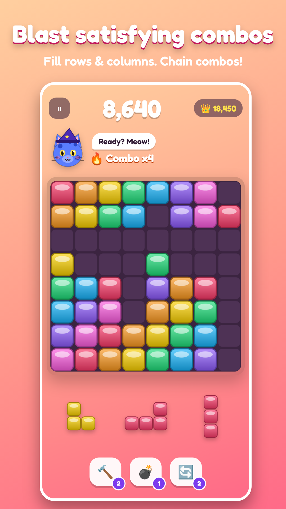

# Blockitty: Cat Block Puzzle 🐱🧱 (v2)

Block puzzle 8×8 con gatti da collezionare. È pensato per il trend n.1 per download su Google Play USA
(block puzzle + gatti) e monetizza con le meccaniche dei giochi che incassano di più.



- **Pubblicazione sul Play Store**: guida passo-passo in [`PUBLISHING.md`](PUBLISHING.md).
- **Scheda dello store** (testi, grafiche, prodotti in-app): [`store/listing.md`](store/listing.md).

## Cosa rende la v2 "trending"

| Area | Scelta | Perché |
|---|---|---|
| Primo avvio | Si entra **subito in partita** con il tutorial, i menu compaiono dopo la prima partita | Ogni schermata prima del gameplay perde utenti |
| Equità | Ogni tris di pezzi è **sempre piazzabile** (verificato dall'algoritmo); inizio più facile, fine partita più impegnativa | "Pezzi impossibili" è la lamentela n.1 nelle recensioni di Block Blast |
| Pubblicità | **Rewarded opzionali** (revive, monete x2, box e spin extra); interstitial solo dalla 4ª partita, al massimo 1 ogni 3 partite e ogni 3 minuti, **mai durante il gioco**; prodotto "No Ads" | Gli annunci aggressivi sono la lamentela n.1 anche per Meowdoku |
| Viralità | **Sfida un amico**: il link fa giocare l'amico con gli *stessi pezzi* dal browser, senza installare nulla. Card del punteggio 1080×1350 per Instagram/TikTok. Gemme bonus alla prima condivisione del giorno | Sfida asincrona più "provalo subito" senza download |
| Abitudine | Streak giornaliera 🔥, login di 7 giorni, missioni, ruota, box gratis, Daily Challenge, notifiche promemoria (chieste solo dopo la prima partita) | Il ciclo che fa tornare ogni giorno |
| Spesa | Collezione a set, Mystery Box con pity, Paw Pass stagionale, offerte giornaliere, Starter Pack, gem pack, No Ads | Le meccaniche di Monopoly GO, Pokémon TCG Pocket e Roblox |
| Semplicità | 4 schede, 2 valute (i doppioni diventano monete), un solo pulsante "Rewards" per tutto il giornaliero | Meno scelte, più gioco |
| Audio | **Colonna sonora originale** generata in tempo reale (menu lo-fi e gioco pop che si intensifica con le combo), meow e SFX sintetizzati | Zero copyright, zero file audio, funziona offline |
| Qualità | Font Fredoka (OFL), rendering fino a 3x, scossa e flash sulle linee, punteggio animato, vignetta di pericolo, haptics nativi | Sensazione "premium" |

## Copyright e licenze
- **Grafica**: gatti, blocchi, icone e banner sono generati dal codice di questo progetto.
- **Musica e suoni**: composizioni originali sintetizzate con WebAudio, senza campioni.
- **Font**: Fredoka, SIL Open Font License (`fonts/OFL-LICENSE.txt`), uso commerciale consentito.
- **Nome**: "Blockitty" e "Paw Pass" sono nomi originali. Non usiamo marchi di altri giochi.

## Sviluppo
```bash
npm install
npm test             # 18 test su logica di gioco ed economia
npm start            # versione web su http://localhost:8080
npm run assets       # rigenera icone, splash e screenshot dello store
npm run android:init # crea il progetto Android (target API 36)
npm run android:apk  # APK di test (serve l'Android SDK)
```
Ogni push avvia **GitHub Actions**, che produce l'APK di test, l'AAB firmato (se la chiave è configurata), la release `blockitty-latest` e il branch `blockitty-apk`.

```
js/core.js     logica pura: board, pezzi equi, scoring
js/state.js    economia, collezione, box, missioni, streak, pass, salvataggi
js/data.js     catalogo e bilanciamento: si modifica tutto da qui
js/game.js     schermata di gioco ed effetti
js/ui.js       menu, negozio, collezione, pass, sfide, risultati
js/audio.js    musica originale + effetti sonori + vibrazione
js/ads.js      AdMob (rewarded/interstitial + consenso GDPR)
js/billing.js  Google Play Billing (demo nel browser)
js/share.js    card del punteggio + link di sfida
js/notify.js   promemoria locali
js/config.js   ID AdMob, URL, regole di frequenza degli annunci
```
